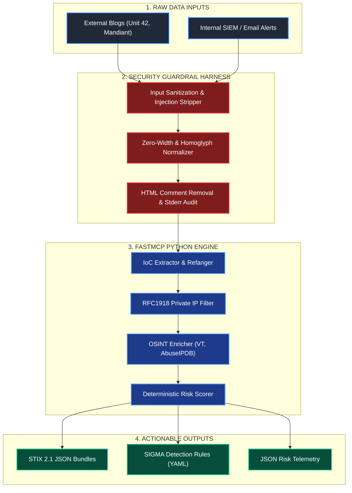

> Full project write-up mirrored from GitHub — source: [Leshan3D/cti-mcp-gateway](https://github.com/Leshan3D/cti-mcp-gateway)
{: .prompt-info }


## Overview (from repo)

An enterprise-grade Model Context Protocol (MCP) gateway built with FastMCP. The system ingests unstructured, untrusted threat intelligence text (scraped blog posts, raw incident summaries, email alerts), defangs and extracts Indicators of Compromise (IoCs), enriches telemetry via OSINT APIs, calculates a deterministic risk score, and generates standard STIX 2.1 bundles and SIGMA detection rules.

The pipeline is fully deterministic by design — no LLM sits inside the scoring or generation path. It incorporates a multi-tiered defense-in-depth security model specifically engineered to mitigate Indirect Prompt Injection (IPI) and Token Smuggling attacks, since its JSON output may be consumed by downstream LLM-based clients (e.g. Cline, Claude Desktop) over MCP stdio channels.

---

## Technical Architecture & Pipeline Mechanics

### Pipeline Data Flow

```text
  [ Raw Untrusted Threat Report ]
                 │
                 ▼
 ┌──────────────────────────────────┐
 │  Tier 1: Adversarial Sanitizer   │ ──► Cleans zero-width chars, homoglyphs,
 └──────────────────────────────────┘     HTML comments; audits to stderr
                 │
                 ▼
 ┌──────────────────────────────────┐
 │ Tier 2: IoC Extractor & Refanger │ ──► Refangs (hxxp, 1[.]1[.]1[.]1), extracts
 └──────────────────────────────────┘     IPv4/domains, filters RFC1918 private IPs
                 │
                 ▼
 ┌──────────────────────────────────┐
 │ Tier 3: OSINT Enrichment         │ ──► Queries AbuseIPDB & VirusTotal APIs
 └──────────────────────────────────┘
                 │
                 ▼
 ┌──────────────────────────────────┐
 │ Tier 4: Deterministic Risk Engine│ ──► Computes 0-100 risk score & verdict
 └──────────────────────────────────┘     purely in Python — no LLM in this path
                 │
                 ▼
 ┌──────────────────────────────────┐
 │ Tier 5: Artifact Generator & MCP │ ──► STIX 2.1 Bundles, SIGMA YAML rules,
 └──────────────────────────────────┘     returned as structured JSON via MCP tool call
```

### Interactive Architecture Diagram



---

## Security Architecture: Defense-in-Depth

Threat intelligence feeds are a primary vector for **Indirect Prompt Injection (IPI)** — an adversary can embed hidden instructions in a public threat report to manipulate any downstream LLM-based agent consuming this tool's output. This gateway implements a 2-tier containment framework:

### Tier 1: Multi-Vector Input Sanitization (`src/engine/sanitizer.py`)
* **Homoglyph Token Smuggling Protection**: Translates visually identical Cyrillic, Greek, and IPA letters into standard Latin ASCII using a custom `CONFUSABLES` translation map (`str.maketrans`).
* **Zero-Width Character Stripping**: Removes invisible Unicode joiners and control characters (`U+200B`, `U+200C`, `U+200D`, `U+2060`, `U+FEFF`) inserted mid-word (e.g., `ig​nore`) to disrupt pattern matching.
* **HTML Comment Scrubbing**: Strips hidden HTML comments (`<!-- ... -->`) across multi-line blocks using regex `DOTALL` flags to neutralize prompt overrides embedded inside scraped threat intel web pages.
* **Transport-Safe Audit Logging**: Security events and regex pattern hits are logged strictly to `sys.stderr`, preserving stdout integrity for FastMCP's JSON-RPC transport.

### Tier 2: Deterministic Execution Core (`src/engine/scorer.py`)
* Extraction, API lookup parsing, and risk score calculation are implemented in pure, deterministic Python code. Even if a sanitization bypass occurred, it could not alter the risk score, verdict, STIX indicator patterns, or SIGMA severity levels — there is no LLM in the decision path to manipulate.

---

## Key Features & Standards Compliance

* **IoC Refanging & Filtering**:
  * Automatically defangs obfuscated indicators (`hxxp://`, `1[.]1[.]1[.]1`, `example[dot]com`).
  * Filters out RFC1918 private IP addresses (`10.0.0.0/8`, `172.16.0.0/12`, `192.168.0.0/16`) and loopback addresses (`127.0.0.1`) from external threat telemetry checks.
* **STIX 2.1 Specification Compliance**:
  * Constructs valid STIX 2.1 JSON Bundles (`bundle--<UUID>`) containing STIX Indicator objects (`indicator--<UUID>`).
  * Employs standard STIX pattern formatting: `[ipv4-addr:value = 'x.x.x.x']` or `[domain-name:value = 'example.com']`.
* **SIGMA Detection Rule Generation**:
  * Emits valid SIGMA YAML detection rules mapped to Zeek/DNS network categories.
  * Auto-populates MITRE ATT&CK taxonomy tags (e.g., `attack.command_and_control`, `attack.t1071`).
  * Dynamically scales SIGMA rule severity (`clean`, `low_risk`, `medium_risk`, `high_risk`, `critical`) based on the computed risk score.

---

## Risk Scoring Methodology

The deterministic scoring algorithm aggregates telemetry from external OSINT providers into a bounded $0–100$ score:

$$\text{Risk Score} = \min\left(100, \sum \text{Factors}\right)$$

| Telemetry Source | Metric | Weighting Formula |
| :--- | :--- | :--- |
| **AbuseIPDB** | Abuse Confidence Score ($0-100\%$) | $\text{Score} \mathrel{+}= \text{AbuseScore} \times 0.5$ |
| **VirusTotal** | Malicious Detection Count | $\text{Score} \mathrel{+}= \text{MaliciousDetections} \times 20$ |

### Verdict Categorization

| Score Range | Verdict | SIGMA Rule Level |
| :--- | :--- | :--- |
| **80 – 100** | `CRITICAL` | `critical` |
| **60 – 79** | `HIGH_RISK` | `high` |
| **40 – 59** | `MEDIUM_RISK` | `medium_risk` |
| **20 – 39** | `LOW_RISK` | `low` |
| **0 – 19** | `CLEAN` | `clean` |

---

## Installation & Setup

### Prerequisites
* Python 3.10+
* `uv` package manager

### 1. Repository Setup

```bash
git clone https://github.com/Leshan3D/cti-mcp-gateway.git
cd cti-mcp-gateway
uv sync
```
